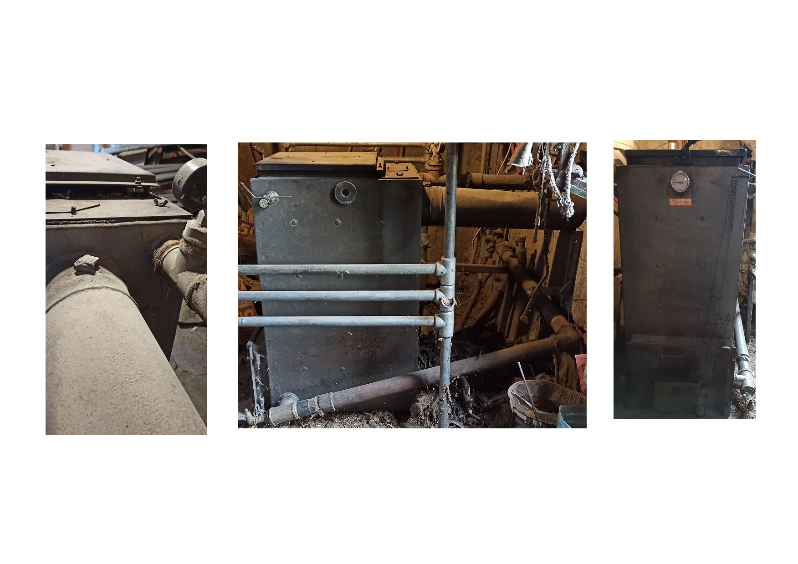
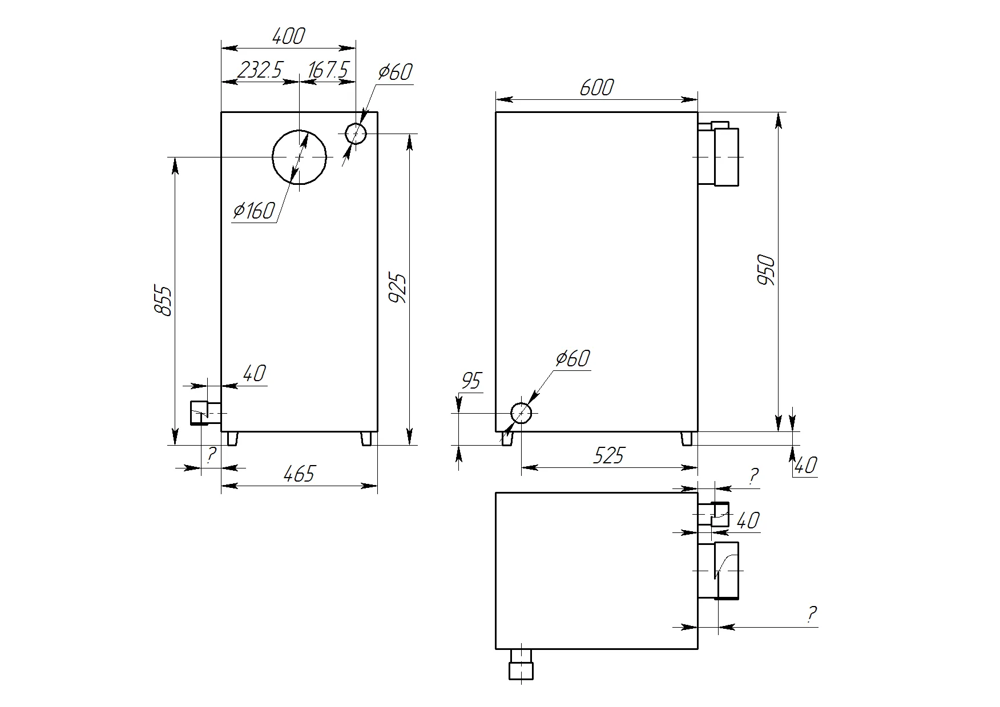

# Замена котла Холмова

По отдельности: [лицевая сторона](./public/origin/photos/front.webp), [боковая](./public/origin/photos/right.webp), [задняя](./public/origin/photos/back.webp).

| Характеристика                     | Значение                                                              |
|------------------------------------|-----------------------------------------------------------------------|
| Название                           | Титан-10 (скорее всего)                                               |
| Высота                             | 950мм (корпус) + 40мм (ножки) + ?мм (крышка)                          |
| Глубина                            | 465мм<!-- todo: уточнить --> (корпус) + 40+?мм (патрубок подачи воды) |
| Длина                              | 600мм (корпус) + ?мм (длина дымохода или трубы вывода воды)           |
| Размер загрузочной камеры (ВxШxГ)  | ?мм x 400мм x 400мм                                                   |
| Диаметр дымохода                   | ⌀169мм наружный (внутренний не могу определить)                       |
| Труба подачи воды (диаметр резьбы) | 2″ (59.62мм)                                                          |
| Труба вывода воды (диаметр резьбы) | 2″ (59.62мм)                                                          |

## Кандидаты

<!-- todo: дописать -->
